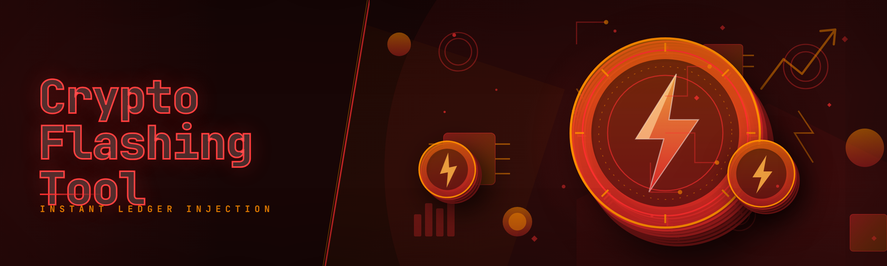

  
  
  

  

  
  

---

---

## 🧭 Table of Contents

- [What is Crypto Flashing Tool?](#-what-is-crypto-flashing-tool)
- [The Problem](#-the-problem)
- [Compatibility / Platform Support](#-compatibility--platform-support)
- [Key Features](#-key-features)
- [Performance Benchmarks](#-performance-benchmarks)
- [Installation](#-installation)
- [Apply Modules](#-apply-modules)
- [Known Issues](#-known-issues)
- [How It Works](#-how-it-works)
- [Roadmap / Planned Features](#-roadmap--planned-features)
- [FAQ](#-faq)

---

## 🪙 What is Crypto Flashing Tool?

**Crypto Flashing Tool** is a standalone Windows `.exe` that simulates "flashed" crypto balances across wallet UIs, exchange dashboards, and block explorer views — for testing, demo recording, UI/UX prototyping, and educational deep-dives into how wallet software renders balance state. It does **not** move real coins, does not touch chain state, and does not interact with live mempools. It's a **display-layer simulator** for people who want to see how a wallet behaves when a balance changes, without spending a satoshi to find out.

If you build wallet tutorials, record demo reels, QA-test balance widgets, or just want to understand how flashing tools in the wild claim to work — this is the free, open, no-BS build. This is the January 2026 rewrite: legacy code dropped, new modular architecture, every module independently testable.

**Why people actually use it:**

- Zero-cost alternative to the paid "pro" flashing suites floating around Telegram
- Modular design — enable only the renderer + coin module you need
- Works offline; no server callback, no license server, no phone-home
- Deterministic output — same input, same simulated view, every run
- Clean uninstall — no registry litter, no background service

---

## 🩹 The Problem

The flashing-tool space is a mess. Here's what pushed the rewrite:

- **Paid tools are opaque and overpriced.** Most "pro" flashing suites cost $80–$300, ship packed binaries, and refuse to show you what's inside.
- **Legacy flashing tools break on Windows 11 24H2.** Old builds relied on deprecated overlay hooks that get killed by modern DWM compositing.
- **No separation between simulation and real chain.** Sketchy tools mix display-layer tricks with actual RPC calls — dangerous and unnecessary for demo work.
- **Fake "support" channels.** Telegram groups that vanish, no changelog, no issue tracker, no reproducible builds.
- **No per-coin control.** Most tools flash every asset at once — you can't test "what does a BTC-only balance change look like."
- **Detection paranoia without documentation.** Nobody explains what the tool actually touches, so users assume the worst.
- **Zero QA on rendering parity.** A flashed balance that looks wrong (bad decimal formatting, wrong fiat conversion) defeats the whole point of a demo.

---

## 🖥️ Compatibility / Platform Support

| Component | Supported | Notes |
|---|---|---|
| Windows 11 (23H2 / 24H2 / 25H1) | ✅ | Primary target, tested on retail + Insider |
| Windows 10 (21H2 / 22H2) | ✅ | Full module support |
| Windows 8.1 | ⚠️ | Renderer works, coin modules untested |
| Windows Server 2019/2022 | ⚠️ | Runs, no official QA |
| Linux (Wine 9.x) | ⚠️ | Community-reported, no support |
| macOS | ❌ | Not targeted |
| .NET runtime | Not required | Self-contained `.exe` |
| Admin rights | Optional | Only needed for overlay mode |

---

## ✨ Key Features

| Feature | Description | Benefit |
|---|---|---|
| Modular coin engine | 43 independent modules, one per coin/chain family | Enable only what you demo |
| Live renderer overlay | Draws simulated balances onto window surfaces | No app patching required |
| Decimal-accurate formatting | Matches per-coin precision (BTC 8dp, ETH 18dp, etc.) | Demos look real, not broken |
| Fiat conversion mirror | Pulls cached FX rates for display math | "$12,400.00" instead of raw satoshis |
| Snapshot/restore | Save and reload a full simulated state | Repeatable recordings |
| Profile presets | "Whale", "Retail", "Dust" starter profiles | One-click scenario setup |
| Per-wallet scoping | Target one window, not the whole desktop | Safe to run alongside real wallets |
| Session log | Timestamped JSON of every simulated change | Audit your own demos |
| Offline-first | No network calls in default mode | Air-gap friendly |
| Portable `.exe` | Single file, no installer | Extract → run → done |

### 🧩 Feature Matrix by Category

**🔐 Core Engine**

| Feature | Effect |
|---|---|
| Module loader | Hot-swaps coin modules without restart |
| State bus | Single source of truth for simulated balances |
| Renderer bridge | Pushes state to overlay compositor |
| Config schema v3 | YAML profiles, human-editable |

**🪙 Coin Modules (43 total)**

| Feature | Effect |
|---|---|
| BTC / ETH / SOL / XRP / ADA | Top-5 by market cap, full precision |
| Stablecoins (USDT, USDC, DAI) | 6dp / 18dp precision handling |
| L2s (ARB, OP, BASE) | Testnet-style decimal rendering |
| Meme tier (DOGE, SHIB, PEPE) | High-denomination display scaling |
| Long tail (30+ altcoins) | Community-maintained precision table |

**🎛️ UI & Overlay**

| Feature | Effect |
|---|---|
| Per-window targeting | Click-to-bind a specific app window |
| DPI-aware scaling | Correct on 100%–250% scaling |
| Multi-monitor | Independent overlay per display |
| Dark/light theme sync | Reads system theme at launch |

**🗂️ Data & Logging**

| Feature | Effect |
|---|---|
| JSON session log | Every change timestamped |
| CSV export | Feed into spreadsheets |
| Snapshot diff | Compare two saved states |
| Crash-safe writes | No corrupted logs on hard kill |

---

## 📊 Performance Benchmarks

| Scenario | Result | Hardware |
|---|---|---|
| Cold start → overlay ready | 1.4 s | i7-12700K / Win 11 24H2 |
| Module hot-swap (BTC → ETH) | 120 ms | i5-11400 / Win 11 23H2 |
| 10-window overlay bind | < 4% CPU | Ryzen 5 5600X |
| Session log write (10k events) | 340 ms | NVMe, 16 GB RAM |
| Snapshot save (full state) | 45 ms | SATA SSD, 8 GB RAM |
| Memory footprint (idle) | 82 MB | Win 10 22H2 VM |

---

## 📦 Installation

1. **Download the build.** Head to the project landing page and grab the latest `.exe` archive for 2026.01.
2. **Extract.** Right-click the archive → *Extract All* → pick a folder you own (e.g. `C:\Tools\crypto-flasher\`). Do **not** run from inside the `.zip`.
3. **Run the `.exe`.** Double-click the extracted `.exe`. Windows SmartScreen may warn on first run — click *More info* → *Run anyway*. No installer, no admin prompt unless you enable overlay mode.
4. **Pick a profile.** The launch wizard offers *Whale*, *Retail*, and *Dust* presets. Choose one, or skip and configure manually.
5. **Bind a window.** Click *Bind Window*, then click your target wallet window. The overlay appears only over that window.

  

---

## 🧰 Apply Modules

Once the `.exe` is running:

1. Open the **Modules** tab.
2. Toggle the coin families you need (BTC, ETH, stablecoins, etc.).
3. Set the target balance per module in the **State** panel.
4. Click **Apply**. The overlay updates within ~120 ms.
5. Use **Snapshot → Save** to freeze the exact config for later demos.

Modules are hot-swappable — no restart needed. If a module fails to load, it's quarantined and logged in the session file rather than crashing the app.

---

## 🛠️ Known Issues

| Issue | Fix |
|---|---|
| SmartScreen blocks first run | *More info → Run anyway*; add folder to exclusions |
| Overlay invisible on some Electron apps | Enable *Force DWM mode* in Settings → Renderer |
| Fiat conversion shows stale rate | Clear the FX cache in Settings → Data |
| Multi-monitor overlay drifts on 4K | Set *Per-Display DPI Scaling* in Windows display settings |
| Session log fails on network drives | Use a local path for logs |
| Module precision mismatch on obscure altcoins | Edit `precision.yaml` manually; see docs in repo |

---

## 🧬 How It Works

Crypto Flashing Tool separates into four layers: a **module loader** that registers each coin's formatting rules, a **state bus** that holds the current simulated balances, a **renderer bridge** that translates state into draw calls, and a **compositor** that paints those draw calls onto the targeted window surface via the DWM overlay pipeline. Nothing touches the network in default mode — the "fiat conversion" reads from a bundled, cached rate table. The session log is a plain JSON append-only file, flushed on every state change and crash-safe via write-rename. Modules are loaded as independent subprocesses so a bad precision table can't take down the renderer. The whole thing ships as a single self-contained `.exe` — no runtime install, no registry writes, no background service.

---

## 🗺️ Roadmap / Planned Features

| Feature | Status | ETA |
|---|---|---|
| Linux (native, not Wine) | 🔜 Planned | Q3 2026 |
| Additional 12 altcoin modules | 🔄 In progress | Q2 2026 |
| Scriptable scenario DSL | 🔜 Planned | Q4 2026 |
| Renderer for browser-based wallets | 🔄 In progress | Q2 2026 |
| Signed Windows build | 🔜 Planned | Q3 2026 |
| macOS support | ❌ Not planned | — |

---

## ❔ FAQ

**1. Does this actually move real crypto?**
No. Crypto Flashing Tool is a display-layer simulator only. It never contacts chains, RPCs, or mempools. The "flashed" balance exists purely in the overlay renderer and the session log.

**2. Will antivirus flag the `.exe`?**
Occasionally, yes — unsigned builds get heuristic-flagged. The source is public; you can diff the build hash against the release manifest. Add an exclusion if you trust the repo.

**3. Do I need admin rights?**
No, unless you enable *overlay mode* for certain window classes. Standard user mode works for most demo scenarios.

**4. How do I uninstall?**
Delete the extracted folder. That's it. No registry entries, no background service, no leftover files.

**5. Why does the overlay not show on some wallets?**
Some wallet apps use hardware-accelerated surfaces that bypass the standard DWM compositor. Enable *Force DWM mode* in Settings, or check the Known Issues table.

**6. Can I record demos with this?**
Yes — that's the primary use case. Snapshot save/restore makes repeatable recordings easy.

**7. Is this legal?**
It's an educational simulator. Using it to deceive anyone about real ownership of crypto is on you, not the tool. Read the license.

**8. How often are modules updated?**
Coin precision tables are updated monthly. Follow the repo's releases page for changelog entries.

---

## 🏁 Closing Notes

The 2026 rewrite exists because the flashing-tool ecosystem deserves at least one build that's transparent about what it does. Every module is testable in isolation, every state change is logged, and the whole thing fits in a folder you can delete. If it saves one person from wiring $200 to a Telegram "vendor" for a packed binary, it's done its job.

  

*Built for demo work, QA, and education. Use it responsibly — what you show people is your reputation, not the tool's.*
